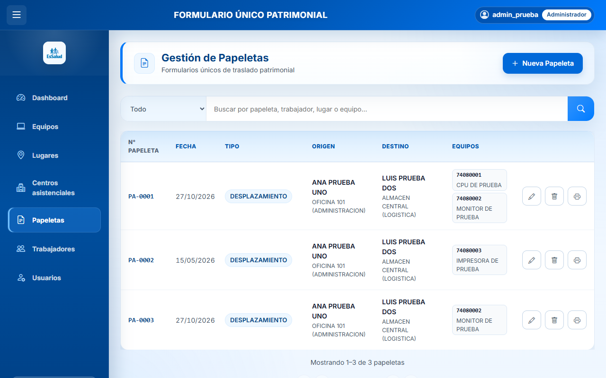
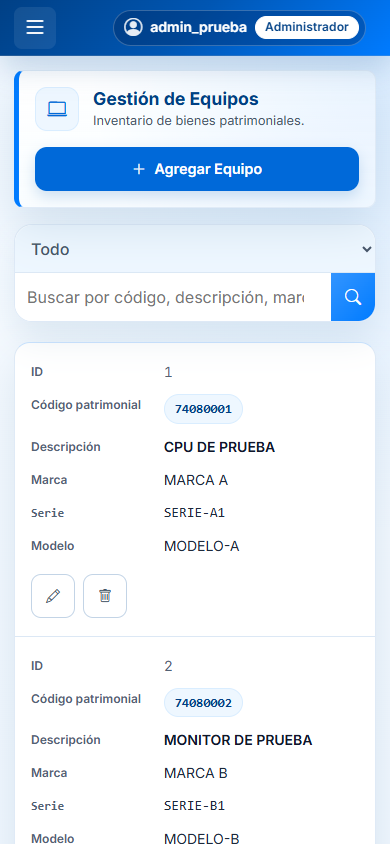
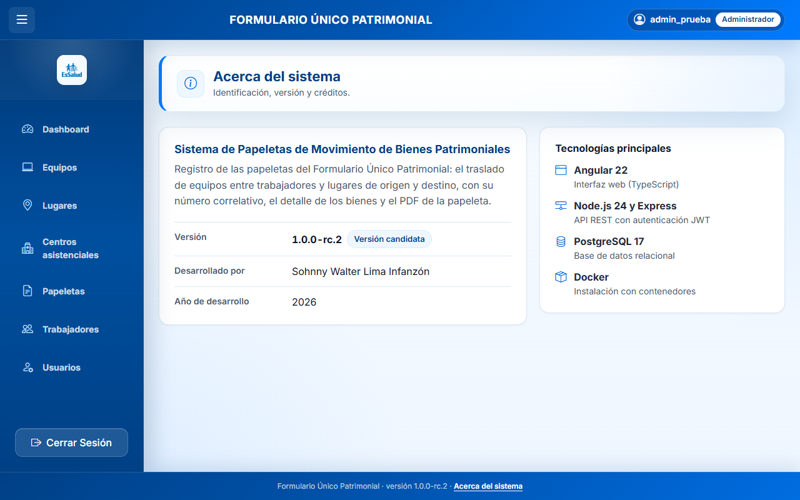

# Sistema de Papeletas de Movimiento de Bienes Patrimoniales

Aplicación web para registrar las **papeletas del Formulario Único Patrimonial** de EsSalud: el traslado de equipos de un trabajador y un lugar de origen a otro de destino, con número correlativo, detalle de los bienes y el PDF de la papeleta generado en el navegador.

**Versión actual: `1.0.0-rc.2`, versión candidata.** Está pendiente de la aceptación del área usuaria y de la validación en producción; todavía no es una versión estable.



## Funcionalidades
- **Papeletas:**
  - alta y edición, con número definitivo `PA-NNNN` asignado por el servidor;
  - origen y destino (trabajador, ambiente, dependencia y centro), y bienes trasladados;
  - búsqueda y paginación;
  - PDF de la papeleta.
- **Equipos, trabajadores y lugares:** registro y búsqueda por campo.
- **Centros asistenciales:** registro, con control de nombres duplicados (solo administradores).
- **Cuentas de usuario** (solo administradores):
  - alta, edición, desactivación y cambio de rol;
  - protección del último administrador y de la propia cuenta.
- **Dashboard** con estadísticas y gráficos.
- **Sesión:**
  - indicador de usuario y rol;
  - sincronización entre pestañas del mismo navegador: cerrar sesión o entrar con otra cuenta actualiza las demás;
  - aviso de sesión caducada.
- **Interfaz adaptable:** listados con el mismo patrón visual; en el móvil, cada registro se muestra como ficha, sin desplazamiento horizontal.
- **«Acerca del sistema»:** versión, tecnologías y créditos, enlazado desde el pie de página.

| Equipos en el móvil | Acerca del sistema |
|---|---|
|  |  |

<sub>Las capturas muestran datos ficticios de un entorno de pruebas.</sub>

## Arquitectura y tecnologías
| Parte | Tecnologías |
|---|---|
| Frontend (`frontend-papeletas/`) | Angular 22 (componentes *standalone*), TypeScript 6, Bootstrap 5.3, Tailwind CSS 3, Chart.js 4, jsPDF 4, SweetAlert2 |
| Backend (`backend-papeletas/`) | Node.js 24 LTS, Express 4.22, `pg` 8, JWT (HS256), bcrypt, helmet, express-rate-limit |
| Base de datos | PostgreSQL 17, con esquema y migraciones versionadas (`backend-papeletas/db/`) |
| Instalación | Docker y Docker Compose: Nginx sin privilegios para la web y el proxy `/api`, la API en Node y PostgreSQL opcional en contenedor |

```
Navegador ──HTTPS──► proxy (institucional o del paquete) ──► Nginx (frontend + /api) ──► API Express ──► PostgreSQL
```
La API y la base de datos no se publican hacia la red: solo el frontend, detrás del proxy HTTPS.

## Roles y seguridad
- **Administrador:** todos los módulos, además de Centros asistenciales y Usuarios. Puede eliminar registros.
- **Usuario:** papeletas, equipos y trabajadores (alta y edición, sin eliminar) y consulta de Lugares.
- **Los permisos los decide el servidor** en cada petición, leyendo el rol en la base de datos; la interfaz solo los refleja. Desactivar una cuenta o cambiar su rol o su contraseña invalida al instante sus sesiones.
- **Medidas de seguridad:**
  - contraseñas con bcrypt y política mínima configurable;
  - límite de intentos de inicio de sesión;
  - cabeceras de seguridad (CSP estricta, `X-Frame-Options`, HSTS con HTTPS);
  - SQL parametrizado;
  - secretos leídos de archivos, nunca de la imagen ni del repositorio;
  - contenedores de solo lectura, sin privilegios ni capacidades.
- **Limitación conocida:** cerrar sesión no revoca el token en el servidor; caduca según `JWT_EXPIRES_IN` (1 h por defecto).

## Requisitos
- **Desarrollo:** Node.js 24.21 (`.node-version`), npm 11 y PostgreSQL 17.
- **Instalación:** Linux x86_64 con Docker Engine 24 o posterior y Docker Compose v2.20 o posterior.

## Puesta en marcha para desarrollo
1. **Base de datos:** cree una base vacía en su PostgreSQL y prepárela con las herramientas del backend:
   ```bash
   cd backend-papeletas
   npm ci
   cp .env.example .env        # ajuste DB_* y JWT_SECRET (32 caracteres como mínimo)
   node scripts/migrar.js --inicializar
   node scripts/migrar.js
   node scripts/migrar.js --catalogos-iniciales
   node scripts/crear-admin.js administrador   # pide la contraseña sin mostrarla
   ```
   Para un entorno de pruebas con datos ficticios en Windows: `docs/revision/pruebas/preparar-bd-prueba.ps1`. Usa un clúster propio en el puerto 55432.
2. **API:** `npm start` (puerto 3000).
3. **Frontend:** en `frontend-papeletas/`, ejecute `npm ci` y `npm start`, y abra http://localhost:4200. `/api` se redirige al puerto 3000 (`proxy.conf.json`).

## Instalación con Docker
- **Desde el repositorio** (construye las imágenes): `deploy/compose.yaml`, más `deploy/compose.db.yaml` si PostgreSQL va en contenedor. Guía en [docs/entrega/guia-instalacion.md](docs/entrega/guia-instalacion.md); detalle en [docs/entrega/docker.md](docs/entrega/docker.md).
- **Paquete de instalación independiente** (recomendado para servidores):
  - **descarga directa**, sin clonar el repositorio: el paquete y su `.sha256` están adjuntos a cada [Release](https://github.com/sohnny-lima/sistema-papeletas-essalud/releases) (versión actual: [`v1.0.0-rc.2`](https://github.com/sohnny-lima/sistema-papeletas-essalud/releases/tag/v1.0.0-rc.2));
  - `deploy/scripts/construir-paquete.sh <etiqueta> <versión> <destino>` genera, desde un commit, un `.tar.gz` con las imágenes (`docker save`), un Compose de producción sin compilación, los scripts y la documentación, con sumas SHA-256;
  - en el servidor, sin repositorio ni Internet: `verificar-paquete.sh` → `instalar.sh` → `comprobar.sh`;
  - incluye copias, restauración, actualización y reversión. Ver [deploy/paquete/documentacion/guia-instalacion.md](deploy/paquete/documentacion/guia-instalacion.md).

## Configuración
Toda la configuración se hace con variables de entorno. Las contraseñas y claves se guardan en **archivos** (`*_FILE`, *secrets* de Docker) y nunca en el repositorio. Plantillas: `backend-papeletas/.env.example`, `deploy/.env.example` y `deploy/paquete/compose/env.example`. Referencia completa: [docs/entrega/configuracion.md](docs/entrega/configuracion.md).

| Variable | Uso |
|---|---|
| `DB_HOST`, `DB_PORT`, `DB_NAME`, `DB_USER` | Conexión de la API (un usuario sin permisos de estructura) |
| `DB_PASSWORD_FILE`, `JWT_SECRET_FILE` | Rutas de los archivos con la contraseña y el secreto JWT |
| `JWT_EXPIRES_IN` | Duración de la sesión (por defecto, `1h`) |
| `TRUST_PROXY` | Saltos o IP de los proxies de confianza (para el límite de intentos por IP) |
| `LOGIN_RATE_LIMIT_MAX`, `LOGIN_RATE_LIMIT_WINDOW_MS` | Límite de intentos fallidos de inicio de sesión |
| `DB_CONNECTION_TIMEOUT_MS` y otros límites `DB_*_TIMEOUT_MS` | Plazos de conexión y de consulta |

## Pruebas
| Suite | Orden |
|---|---|
| API (`node:test`, base propia `bd_papeleta_ci`) | `cd backend-papeletas && npm test` |
| Frontend (Karma y Jasmine) | `cd frontend-papeletas && npx ng test --watch=false --browsers=ChromeHeadless` |
| Extremo a extremo (Playwright con Chrome) | `docs/revision/pruebas/e2e/`, con `npm ci` y `node flujos-ui.mjs` |
| Instalación Docker completa, con las pruebas extremo a extremo | `bash deploy/scripts/humo.sh --e2e` |

La integración continua está en `.github/workflows/ci.yml`. Las pruebas usan un esquema de base de datos reconstruido y datos ficticios.

## Estructura del proyecto
```
backend-papeletas/    API: routes → controllers → config/database.js; utils/, middlewares/, db/ (esquema y migraciones), scripts/ y test/
frontend-papeletas/   SPA Angular: src/app/ (un componente por módulo; services/ con el acceso HTTP y la sesión) y nginx/
deploy/               Docker Compose, scripts de operación (copias, restauración, humo) y paquete de instalación (deploy/paquete/)
docs/entrega/         Guías de instalación, configuración, base de datos, copias, actualización, manual de uso y lista de aceptación
docs/revision/pruebas Pruebas extremo a extremo y base de pruebas local
```

## Versiones
| Versión | Estado |
|---|---|
| `1.0.0-rc.2` | Versión candidata actual: imagen de producción sin datos de demostración, paquete de instalación independiente con HTTPS, sesión entre pestañas, listados adaptables y «Acerca del sistema». Pendiente de aceptación |
| `1.0.0-rc.1` | Primera versión candidata: revisión integral, Docker, migraciones, copias y cuentas de usuario |

La versión `1.0.0` estable se publicará tras la aceptación del área usuaria y la validación en producción.

## Créditos
Desarrollado por **Sohnny Walter Lima Infanzón** (2026).

## Licencia y condiciones de uso
Este repositorio **todavía no tiene una licencia definida**. Las condiciones de uso, modificación y distribución están pendientes de la verificación de derechos con EsSalud; hay un borrador en `docs/entrega/propuestas/`.
